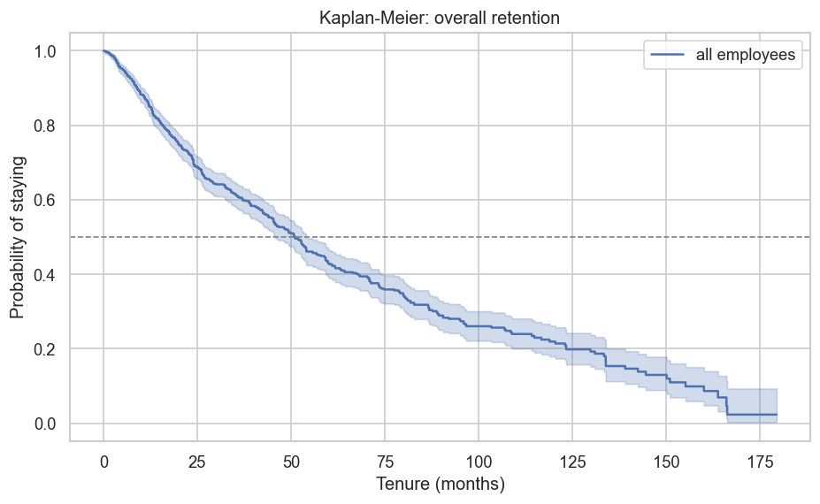
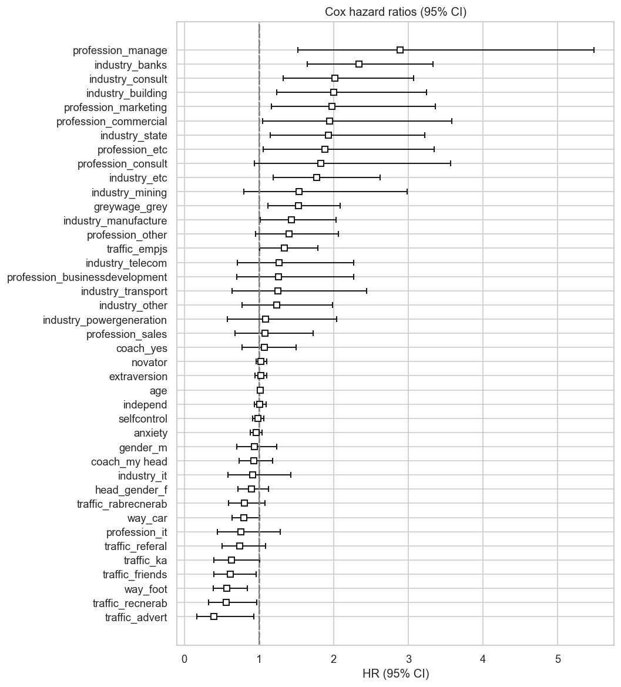
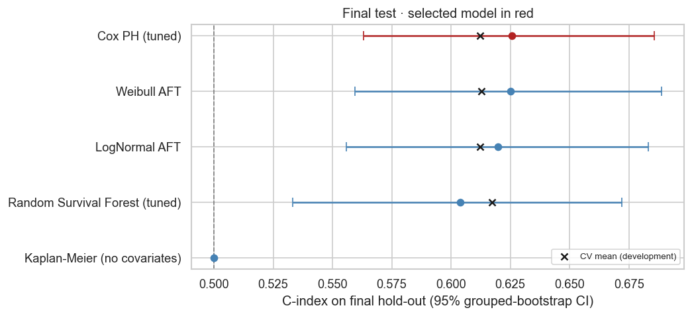

# Employee Turnover — Survival Analysis

[](https://github.com/Pandolfiz/Employee-Turnover/actions/workflows/tests.yml)

**[English](#english) · [Português](#português)**

---

## English

### Why survival analysis?
Turnover is a *time-to-event* problem: the question is not only **whether** an employee leaves,
but **when**. Employees still on the payroll are **right-censored**: we only know they stayed
*at least* their current tenure. Classification models (left / stayed) and simple tenure averages
ignore that information and are biased; survival models use it correctly.

### Questions
1. What is the retention curve, and what is the median tenure?
2. Which factors (recruitment channel, salary formality, commute, mentoring, personality…) speed up or slow down attrition?
3. Do these effects hold over time (proportional hazards)?
4. How well can we predict individual risk on unseen employees?

### Data
[Employee Turnover dataset](https://www.kaggle.com/datasets/davinwijaya/employee-turnover) by Edward Babushkin:
~1,129 employees, tenure in months (`stag`) and an exit indicator (`event`), plus demographic,
job and Big-Five-style personality variables. See the [data dictionary](data/README.md).

**Repeated profiles:** ~41% of rows share an identical 5-score personality profile with another
row (groups of up to 5), most likely the same person in different jobs. Rows sharing a profile
get the same `profile_id`, which is used for **grouped train/test splits** (no person on both sides)
and **cluster-robust standard errors** in the Cox model.

### Methods
| Notebook | Content |
|---|---|
| [01_eda](notebooks/01_eda.ipynb) | Censoring, tenure distribution, covariates |
| [02_kaplan_meier](notebooks/02_kaplan_meier.ipynb) | Kaplan-Meier, Nelson-Aalen hazard, log-rank tests by group |
| [03_cox_ph](notebooks/03_cox_ph.ipynb) | Cox PH for inference (unpenalised, cluster-robust SEs), hazard ratios, Schoenfeld PH diagnostics |
| [04_parametric_aft](notebooks/04_parametric_aft.ipynb) | Weibull / log-normal / log-logistic AFT, time ratios |
| [05_ml_and_evaluation](notebooks/05_ml_and_evaluation.ipynb) | Random Survival Forest, single hold-out comparison (C-index, time-dependent AUC, integrated Brier score), 12-month risk scoring |
| [06_robust_validation](notebooks/06_robust_validation.ipynb) | Leakage-safe protocol: 80/20 grouped development / final hold-out split, naive vs grouped CV, shuffled-outcome negative control, nested repeated CV with fold-wise preprocessing, pre-registered model-selection rule, out-of-fold calibration, one-shot hold-out test with grouped-bootstrap CIs |

### Results
1,116 employees after removing 13 exact duplicates; 560 left (50% censored).

#### 1 · Retention
Median tenure is **51 months** (Kaplan-Meier). About 1 in 7 employees leaves within the first year.

| Tenure | 3 m | 6 m | 12 m | 24 m | 36 m | 60 m |
|---|---|---|---|---|---|---|
| Still employed | 98% | 94% | 86% | 70% | 61% | 43% |



#### 2 · What drives turnover (Cox PH)
Unpenalised Cox model on all data with cluster-robust standard errors (by `profile_id`).
Each hazard ratio (HR) compares a group with the most common group of its variable;
HR > 1 means a higher risk of leaving at any point in time.

| Higher risk | HR (95% CI) | Lower risk | HR (95% CI) |
|---|---|---|---|
| Manager vs HR | 2.74 (1.80–4.16) | Recommended by a non-employee friend vs job-site application | 0.54 (0.33–0.86) |
| Construction vs retail | 2.36 (1.54–3.62) | Applied directly after ads / employer brand | 0.53 (0.28–0.99) |
| Banking vs retail | 2.21 (1.56–3.13) | Invited by an employer who knew them | 0.58 (0.40–0.85) |
| Commercial role vs HR | 2.21 (1.26–3.90) | Recruitment agency | 0.60 (0.39–0.94) |
| Consulting vs retail | 1.89 (1.23–2.92) | Walks to work vs bus | 0.63 (0.44–0.92) |
| Partly informal ("grey") salary | 1.63 (1.24–2.13) | Drives to work vs bus | 0.80 (0.65–0.99) |
| Employer found résumé on job site vs own application | 1.34 (1.00–1.80) | | |
| Age (per year) | 1.02 (1.00–1.03) | | |

- **Not significant after adjustment:** the five personality scales, gender, supervisor gender
  and having a coach. Extraversion and self-control differ in unadjusted log-rank tests but not in
  the Cox model.
- **Repeated profiles barely matter for inference:** robust and naive standard errors give the
  same 17 significant effects.
- **Proportional hazards:** borderline violations (p 0.01–0.04) for 5 of 41 covariates (`novator`,
  two recruitment channels, sales profession, "other" industry), about what chance alone would
  produce at α = 0.05; the Weibull AFT model (no PH assumption) agrees on the direction of all
  17 significant effects.



#### 3 · Predictive performance (leakage-safe, notebook 06)
- **No leakage:** with the outcome shuffled, the full pipeline scores C-index 0.504 (Cox) and
  0.502 (RSF), i.e. chance level. Ignoring the repeated profiles would inflate the C-index by only
  0.006–0.009.
- **Development set (80%), nested 5×3 grouped CV:** all models land at C-index ≈ 0.61–0.62 and
  beat the covariate-free Kaplan-Meier on the integrated Brier score (0.194–0.199 vs 0.207).
  The Random Survival Forest is nominally best but **not significantly** (corrected t-test p = 0.16),
  so the pre-registered rule selected the **Cox model**.
- **Calibration (out-of-fold):** Cox and RSF are the best calibrated (mean error 1.5 p.p. at 12 months);
  the AFT models are off by 3–5 p.p.
- **Final hold-out (20%, evaluated once, 95% grouped-bootstrap CI):**

| Model | C-index | Integrated Brier score | CV C-index |
|---|---|---|---|
| **Cox PH (selected)** | **0.626 (0.563–0.686)** | 0.173 (0.152–0.196) | 0.612 |
| Weibull AFT | 0.625 (0.559–0.689) | 0.169 (0.145–0.197) | 0.613 |
| LogNormal AFT | 0.620 (0.556–0.683) | 0.172 (0.148–0.196) | 0.612 |
| Random Survival Forest | 0.604 (0.533–0.672) | 0.172 (0.150–0.194) | 0.617 |
| Kaplan-Meier (no covariates) | 0.500 | 0.186 (0.163–0.208) | — |

The hold-out results match the CV estimates, so the development estimates were not optimistic.
Discrimination is **moderate**: the model ranks who leaves first correctly in ~62% of comparable pairs.



#### Limitations
- Associations, not causal effects: e.g. the industry or recruitment channel may proxy for unobserved job features.
- Voluntary quits and dismissals are not distinguished, so competing-risks models are not possible.
- Two thirds of the sample are HR professionals, all in Russia; results may not generalise.
- The units of `stag` and the timing of `age` are not documented by the source (see the [data dictionary](data/README.md)).
- With 242 rows, the hold-out confidence intervals are wide.

### Quick start
```bash
git clone https://github.com/Pandolfiz/Employee-Turnover.git && cd Employee-Turnover
python -m venv .venv
source .venv/bin/activate          # Windows: .venv\Scripts\activate
pip install -r requirements.txt    # also installs the local package in editable mode
python scripts/download_data.py    # kagglehub, no token needed for this public dataset
jupyter lab notebooks/
pytest                             # tests run on synthetic data, no download needed
```

### Project structure
```
├── data/                 raw/ & processed/ (git-ignored) + data dictionary
├── notebooks/            01 → 06 analysis notebooks
├── reports/figures/      figures saved by the notebooks
├── scripts/              download_data.py
├── src/turnover_survival/
│   ├── config.py         paths, column roles, defaults
│   ├── data.py           load, clean, profile_id, DesignMatrixBuilder (fit on train only), grouped splits
│   ├── nonparametric.py  Kaplan-Meier, Nelson-Aalen, log-rank
│   ├── models.py         Cox PH (cluster-robust), AFT models, Random Survival Forest, grouped tuning
│   ├── evaluation.py     metrics, nested CV, leakage controls, model selection, hold-out, calibration
│   └── synthetic.py      synthetic data with the same schema (tests only)
└── tests/                pipeline tests + data-leakage guards (shuffled-outcome control)
```

---

## Português

### Por que análise de sobrevivência?
Turnover é um problema de **tempo até o evento**: importa não só **se** o funcionário sai,
mas **quando**. Quem ainda está na empresa é uma observação **censurada à direita**: sabemos
apenas que ficou *pelo menos* o tempo atual de casa. Modelos de classificação (saiu / ficou) e
médias simples de tempo de casa desperdiçam essa informação e geram viés.

### Perguntas
1. Qual é a curva de retenção e a mediana de tempo de casa?
2. Quais fatores (canal de recrutamento, salário informal, deslocamento, mentoria, personalidade…) aceleram ou retardam a saída?
3. Esses efeitos são constantes no tempo (riscos proporcionais)?
4. Quão bem conseguimos prever o risco individual em funcionários não vistos?

### Dados
Dataset [Employee Turnover](https://www.kaggle.com/datasets/davinwijaya/employee-turnover) de Edward Babushkin:
~1.129 funcionários, tempo de casa em meses (`stag`) e indicador de saída (`event`), além de
variáveis demográficas, do cargo e de personalidade. Veja o [dicionário de dados](data/README.md).

**Perfis repetidos:** ~41% das linhas repetem exatamente o perfil de personalidade de outra linha
(grupos de até 5), provavelmente a mesma pessoa em empregos diferentes. Essas linhas recebem o mesmo
`profile_id`, usado para **divisões treino/teste agrupadas** e **erros-padrão robustos por cluster** no Cox.

### Métodos
1. **EDA**: censura, distribuição do tempo de casa e covariáveis;
2. **Kaplan-Meier e log-rank**: curvas de retenção e comparação entre grupos;
3. **Cox PH para inferência** (sem penalização, erros-padrão robustos): hazard ratios ajustados e diagnóstico de riscos proporcionais (resíduos de Schoenfeld);
4. **AFT paramétricos** (Weibull, log-normal, log-logística): *time ratios* e mediana prevista;
5. **Random Survival Forest** e comparação no conjunto de teste (C-index, AUC dependente do tempo, Integrated Brier Score), mais um score de risco de saída em 12 meses;
6. **Validação sem vazamento**: divisão 80/20 agrupada entre desenvolvimento e teste final, CV ingênua vs agrupada, controle negativo com desfecho embaralhado, CV repetida e aninhada com pré-processamento por fold, regra de seleção pré-definida, calibração *out-of-fold* e teste final avaliado uma única vez (IC por bootstrap agrupado).

### Resultados
1.116 funcionários após remover 13 duplicatas exatas; 560 saíram (50% censurados).
Os gráficos estão na [seção em inglês](#results).

#### 1 · Retenção
O tempo de casa mediano é de **51 meses** (Kaplan-Meier). Cerca de 1 em cada 7 funcionários sai no primeiro ano.

| Tempo de casa | 3 m | 6 m | 12 m | 24 m | 36 m | 60 m |
|---|---|---|---|---|---|---|
| Ainda na empresa | 98% | 94% | 86% | 70% | 61% | 43% |

#### 2 · O que influencia o turnover (Cox PH)
Modelo de Cox sem penalização, ajustado em todos os dados, com erros-padrão robustos por `profile_id`.
Cada hazard ratio (HR) compara um grupo com o grupo mais comum da sua variável; HR > 1 significa
maior risco de saída a cada momento.

| Mais risco | HR (IC 95%) | Menos risco | HR (IC 95%) |
|---|---|---|---|
| Gerência vs RH | 2,74 (1,80–4,16) | Recomendado por amigo que não é funcionário vs candidatura em site | 0,54 (0,33–0,86) |
| Construção vs varejo | 2,36 (1,54–3,62) | Procurou a empresa por anúncio / marca | 0,53 (0,28–0,99) |
| Bancos vs varejo | 2,21 (1,56–3,13) | Convidado por empregador que já o conhecia | 0,58 (0,40–0,85) |
| Área comercial vs RH | 2,21 (1,26–3,90) | Agência de recrutamento | 0,60 (0,39–0,94) |
| Consultoria vs varejo | 1,89 (1,23–2,92) | Vai a pé ao trabalho vs ônibus | 0,63 (0,44–0,92) |
| Salário parcialmente informal ("grey") | 1,63 (1,24–2,13) | Vai de carro vs ônibus | 0,80 (0,65–0,99) |
| Empregador encontrou o currículo em site vs candidatura própria | 1,34 (1,00–1,80) | | |
| Idade (por ano) | 1,02 (1,00–1,03) | | |

- **Sem efeito significativo após o ajuste:** as cinco escalas de personalidade, gênero, gênero do
  gestor e ter mentor. Extroversão e autocontrole aparecem nos testes log-rank sem ajuste, mas não no Cox.
- **Os perfis repetidos quase não afetam a inferência:** erros-padrão robustos e ingênuos dão os
  mesmos 17 efeitos significativos.
- **Riscos proporcionais:** violações no limite (p entre 0,01 e 0,04) em 5 de 41 covariáveis
  (`novator`, dois canais de recrutamento, profissão de vendas e setor "outros"), próximo do que o
  acaso produziria com α = 0,05; o modelo Weibull AFT, que não assume PH, concorda na direção dos
  17 efeitos significativos.

#### 3 · Desempenho preditivo (sem vazamento, notebook 06)
- **Sem vazamento:** com o desfecho embaralhado, o pipeline completo dá C-index de 0,504 (Cox) e
  0,502 (RSF), ou seja, nível de acaso. Ignorar os perfis repetidos inflaria o C-index em apenas 0,006–0,009.
- **Desenvolvimento (80%), CV agrupada e aninhada 5×3:** todos os modelos ficam em C-index ≈ 0,61–0,62
  e superam o Kaplan-Meier sem covariáveis no Integrated Brier Score (0,194–0,199 vs 0,207).
  A Random Survival Forest é nominalmente a melhor, mas **sem significância** (t-test corrigido p = 0,16),
  então a regra pré-definida escolheu o **modelo de Cox**.
- **Calibração (out-of-fold):** Cox e RSF são os mais bem calibrados (erro médio de 1,5 p.p. em 12 meses);
  os modelos AFT erram de 3 a 5 p.p.
- **Teste final (20%, avaliado uma única vez, IC 95% por bootstrap agrupado):**

| Modelo | C-index | Integrated Brier Score | C-index na CV |
|---|---|---|---|
| **Cox PH (escolhido)** | **0,626 (0,563–0,686)** | 0,173 (0,152–0,196) | 0,612 |
| Weibull AFT | 0,625 (0,559–0,689) | 0,169 (0,145–0,197) | 0,613 |
| LogNormal AFT | 0,620 (0,556–0,683) | 0,172 (0,148–0,196) | 0,612 |
| Random Survival Forest | 0,604 (0,533–0,672) | 0,172 (0,150–0,194) | 0,617 |
| Kaplan-Meier (sem covariáveis) | 0,500 | 0,186 (0,163–0,208) | — |

O resultado no teste final bate com a CV, então as estimativas do desenvolvimento não eram otimistas.
A discriminação é **moderada**: o modelo acerta quem sai primeiro em ~62% dos pares comparáveis.

#### Limitações
- São associações, não efeitos causais: setor ou canal de recrutamento podem refletir características não observadas do cargo.
- Saídas voluntárias e demissões não são distinguidas, o que impede modelos de riscos competitivos.
- Dois terços da amostra são profissionais de RH, todos na Rússia; os resultados podem não se generalizar.
- A unidade de `stag` e o momento da medição de `age` não são documentados pela fonte (ver o [dicionário de dados](data/README.md)).
- Com 242 linhas, os intervalos de confiança do teste final são largos.

### Como rodar
Veja o [Quick start](#quick-start) acima. Os comandos são os mesmos.

---

**Stack:** Python · pandas · lifelines · scikit-survival · scikit-learn · matplotlib/seaborn
